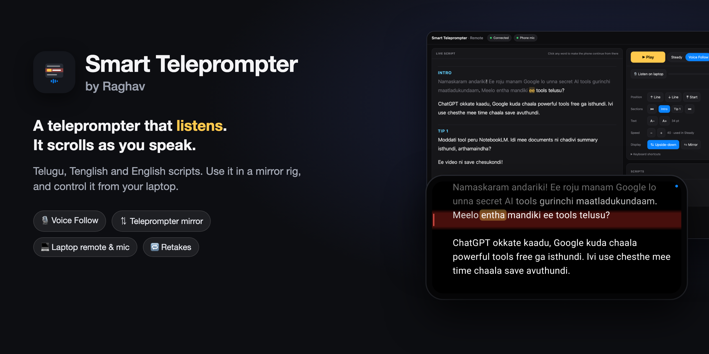
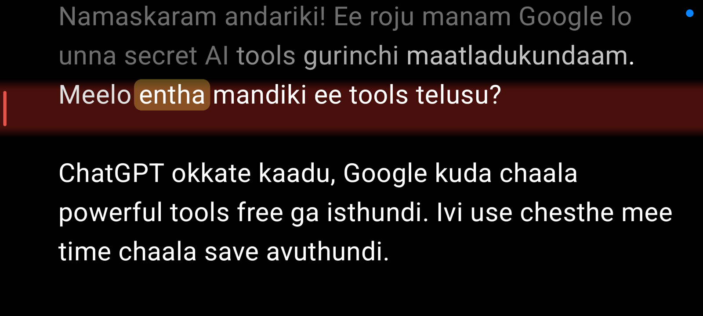
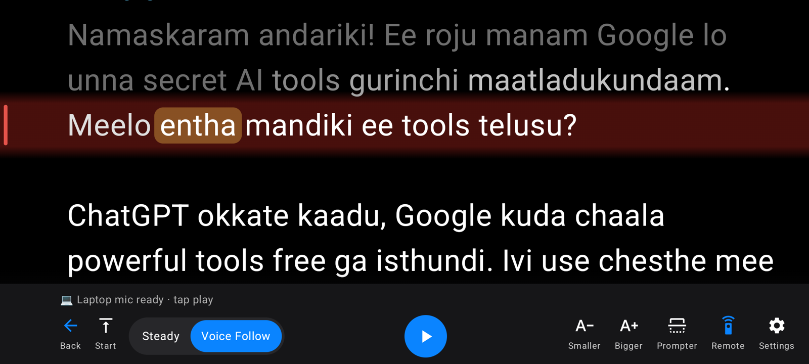
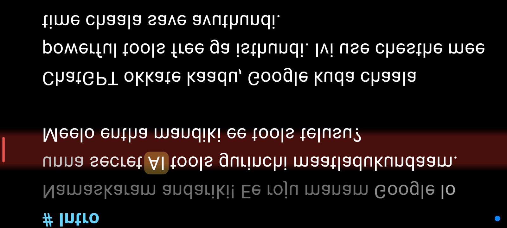
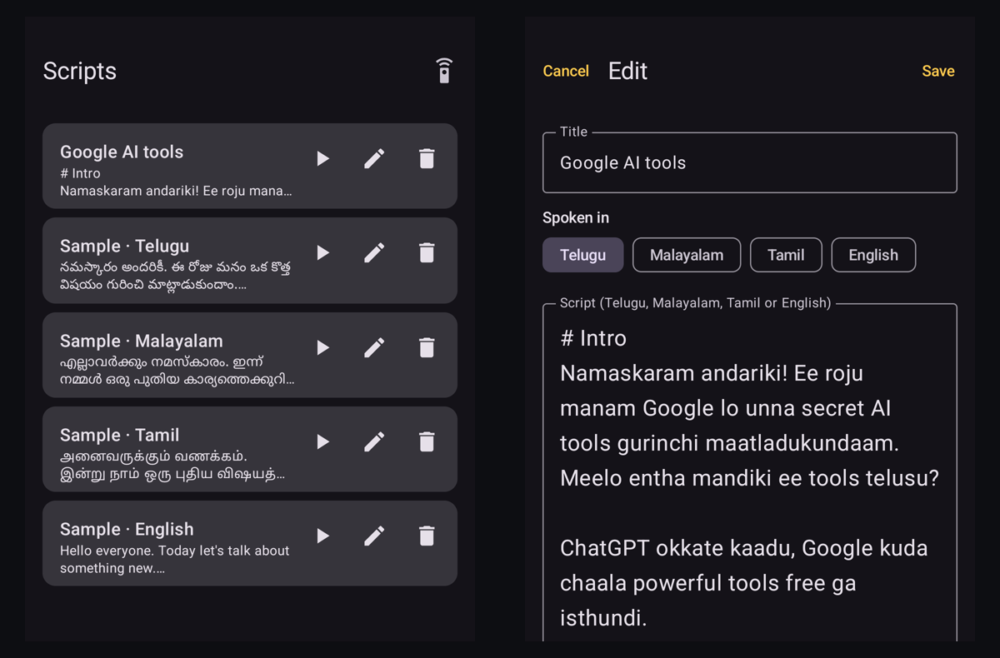
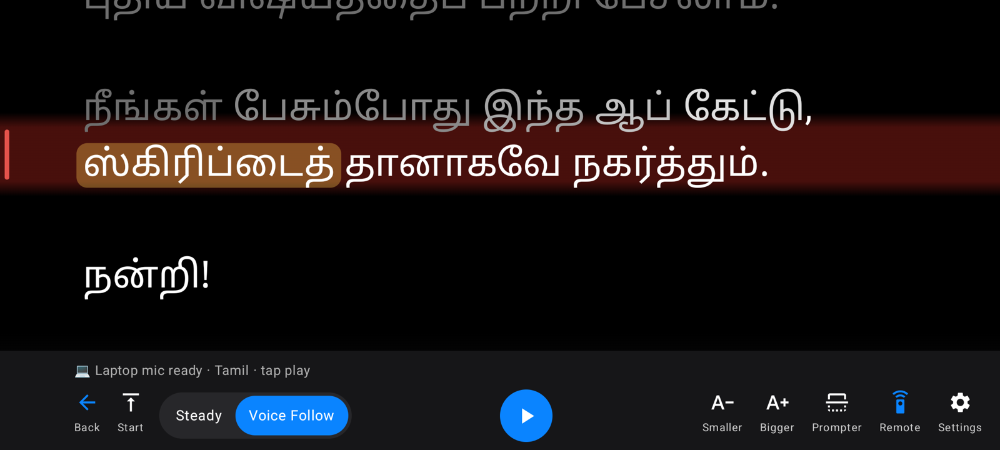
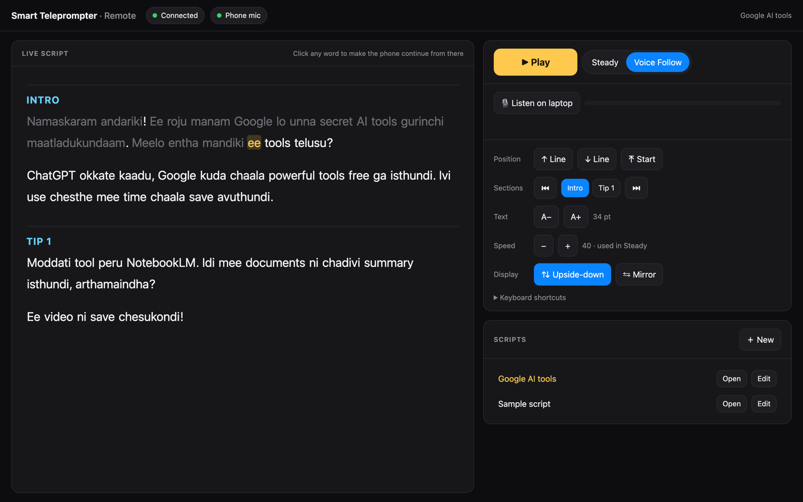

<p align="center">
  
</p>

<p align="center">
  <a href="https://github.com/raghavsunil99/smart-teleprompter/releases/latest"></a>
  <a href="https://github.com/raghavsunil99/smart-teleprompter/releases"></a>
  
  
</p>

<p align="center">
  <b>Smart Teleprompter listens while you talk and scrolls your script along with you.</b><br>
  For <b>Telugu, Malayalam, Tamil and English</b> creators. Write scripts in their own letters or type them in English letters.
</p>

<p align="center">
  <a href="#-download">Download</a> ·
  <a href="#-features">Features</a> ·
  <a href="#-languages">Languages</a> ·
  <a href="#-laptop-remote">Laptop remote</a> ·
  <a href="#-in-a-teleprompter-rig">Teleprompter rig</a> ·
  <a href="#-questions">Questions</a> ·
  <a href="CHANGELOG.md">Changelog</a>
</p>

<p align="center">
  
</p>

## 🆕 What's new in 1.7

- **English words inside Telugu, Malayalam or Tamil scripts** now follow smoothly, even when the recognizer writes them in its own letters: *time*, *save*, *cache*, and joined words like *useState*.
- **Numbers** match how they're said: *5* = five = ఐదు.
- **Scrolling keeps going while you're talking**, even through a word it can't match, and only slows when you actually stop.

Full history in the [changelog](CHANGELOG.md).

## ⬇ Download

| Device | File | Notes |
|---|---|---|
| 🤖 **Android** 8+ phone or tablet | [Smart-Teleprompter-by-Raghav-1.7.apk](https://github.com/raghavsunil99/smart-teleprompter/releases/latest) | Allow installing from your browser or Files app, then **Install anyway** |
| 💻 **Laptop remote** (optional) | Nothing to install | Open the address the app shows in **Chrome** on a laptop on the same Wi-Fi |

Step-by-step instructions: [HOW TO INSTALL SMART TELEPROMPTER.txt](docs/HOW%20TO%20INSTALL%20SMART%20TELEPROMPTER.txt). Installing a new version over an old one keeps your scripts.

## ✨ Features

<table>
<tr>
<td width="50%" valign="top">

### 🎙 Voice Follow
Start talking and the script moves with you. It works out which word you're on and scrolls at your own pace, like cruise control: steady while you speak, gliding to a stop when you pause.

</td>
<td width="50%" valign="top">

### ⇅ Built for teleprompter glass
One tap flips the text for a mirror rig and locks landscape. While you record, the screen is just your script on black, with a soft red band on the line to read.

</td>
</tr>
<tr>
<td></td>
<td></td>
</tr>
<tr>
<td width="50%" valign="top">

### 🔁 Retakes and sections
Start a sentence again and the script glides back to it. Mark parts with `# Intro`, `# Tip 1` and jump between them. Each script remembers where you stopped.

</td>
<td width="50%" valign="top">

### 🎮 Remotes and pedals
Bluetooth clickers, foot pedals, keyboards and camera-shutter remotes work out of the box: play/pause, next and previous line, back to start.

</td>
</tr>
<tr>
<td width="50%" valign="top">

### ⏱ The details
A 3-2-1 countdown, a gliding word highlight (or whole line, or none), Steady mode at a fixed speed, and adjustable reading band, text size and brightness.

</td>
<td width="50%" valign="top">

### 🔒 Private by design
No account and no ads. Scripts stay on your phone. The laptop remote works over your own Wi-Fi, with an optional PIN.

</td>
</tr>
</table>

## 🗣 Languages

| Language | Write the script in | Example: these all match |
|---|---|---|
| **Telugu** | తెలుగు letters or English letters | నమస్కారం · *namaskaram* |
| **Malayalam** | മലയാളം letters or English letters | നമസ്കാരം · *namaskaram* |
| **Tamil** | தமிழ் letters or English letters | வணக்கம் · *vanakkam* |
| **English** | English | *Hello everyone* |

Scripts in Telugu, Malayalam or Tamil letters are recognised automatically. For a script typed in English letters, choose the language you'll speak in the editor ("Spoken in"). English words inside an Indian-language script, like *video* or *subscribe*, are understood too.

<p align="center">
  
</p>
<p align="center">
  
</p>

## 💻 Laptop remote

Turn on **Remote** in the app and open the address it shows in Chrome on your laptop. No PIN by default; switch on **Require PIN** on public Wi-Fi.

- **Live script**: see exactly where the phone is, and click any word to make it continue from there.
- **Laptop mic**: if the phone is a couple of metres away in a rig, let the laptop in front of you do the listening. The phone follows it, and switches back to its own mic if the laptop stops.
- **Control everything**: play, mode, language, lines, sections, text size, speed and flip, with keyboard shortcuts.
- **Write scripts on the laptop** and send them to the phone.

<p align="center">
  
</p>

> The laptop mic needs the **https** address. The first time, Chrome says "Your connection is not private": click **Advanced → Proceed**. It's your own phone on your own Wi-Fi.

## 🎬 In a teleprompter rig

1. Put the phone in the rig and tap **Prompter** (flips the text and locks landscape).
2. Record on another phone or camera behind the glass.
3. Press ▶ on the phone, a remote, or the laptop, and start talking after the countdown.

If the phone is far from you, use the **laptop mic**. If you lose your place, long-press a word on the phone or click it on the laptop.

## ❓ Questions

**It says the language isn't available.**
Speech recognition comes from Google. Open the Google app → Settings → Voice → Languages and add Telugu, Malayalam or Tamil (you can also download it for offline use).

**Does it need internet?**
Usually, yes: recognition runs on Google's speech service unless the language is downloaded for offline use.

**The text is mirrored the wrong way in my rig.**
Most phone rigs need **Prompter** (upside-down). If yours reads backwards, open Settings and use **Mirror left-right** instead.

**The laptop can't connect to the phone.**
Both must be on the same Wi-Fi. Office and hotel networks often block devices from reaching each other; use the phone's hotspot instead.

**Why does the app show a green microphone dot?**
That's Android's privacy indicator while the phone's mic is listening. Apps can't hide it.

---

## Build from source

The rest of this page is for developers.

Needs JDK 17 and the Android SDK (platform 35).

```bash
./gradlew assembleDebug        # app/build/outputs/apk/debug/app-debug.apk
./gradlew testDebugUnitTest    # unit tests
```

## How it works

- **Listening**: Android's speech recognizer in the script's language (`te-IN`, `ml-IN`, `ta-IN` or `en-IN`), with partial results, kept running across pauses (one segmented session on Android 13+). The laptop remote uses Chrome's Web Speech API in the same language and sends what it hears over a WebSocket.
- **Matching** (`ScriptMatcher`): the last few heard words are aligned to the script near the current position. Telugu, Malayalam and Tamil letters, and English-letter typing, are all turned into the same Latin sound key (`Phonetic`); for Tamil, sounds its script writes with one letter (k/g, t/d, p/b) count as the same. English words also match on how they sound (`Phonetic.soundKeys`), and joined words like `useState` are followed as two words. The further ahead a match is, the more (and the more contiguous) matching words it needs, and only newly heard words can move the position, so repeated phrases in other sections don't pull it away. A restarted sentence is a retake.
- **Scrolling** (`CruiseFollower`): scrolls at the speaker's measured pace in pixels per second and corrects drift over about two seconds, rather than chasing each burst of recognized words. While speech is heard it keeps going, even through words that don't match. Drawn with sub-pixel offsets.
- **Remote** (`RemoteServer`, `RemoteHub`): a small web server on the phone, over http and https, serving the remote page plus a WebSocket for commands, heard words and live status.

## Layout

- `app/src/main/java/com/telugu/prompter/`
  - `PrompterScreen.kt`: the prompter: scrolling, highlight, controls, settings
  - `ScriptMatcher.kt`, `Phonetic.kt`, `ScriptLanguage.kt`: following the speaker through the script, in each language
  - `CruiseFollower.kt`: the voice-follow scroll; `ScrollFollower.kt` is the older word-based one, kept as the smoothness baseline in tests
  - `SpeechFollower.kt`: Android speech recognition
  - `RemoteServer.kt`, `RemoteHub.kt`: laptop remote server and the Remote dialog
  - `RemoteKeys.kt`: Bluetooth remotes, pedals and keyboards
  - `ScriptStore.kt`, `ScriptScreens.kt`, `MainActivity.kt`: scripts, settings, list and editor
- `app/src/main/assets/remote.html`: the laptop remote page
- `app/src/test/`: matcher, languages, retake, smoothness, remote server and key tests

## Notes

- The https address uses a self-signed certificate bundled in the app, which is why Chrome asks you to proceed the first time.
- The app id is still `com.telugu.prompter` (from its first version), so new versions install over old ones and keep your scripts.
